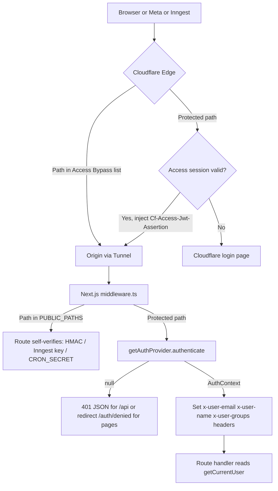

# Auth Wireframe — Pluggable Provider, Cloudflare Access Primary

Goal: one authentication seam in the app so Cloudflare Access is the production identity source today, but swapping to Auth.js / Clerk / SSO later is a single-file change plus an env var. Everything downstream (route handlers, audit log, override tracking, workspace membership) consumes only an `AuthContext` and never knows which provider produced it.

---

## 1. Request Flow



Two layers of defence: Cloudflare enforces login at the edge; the app independently verifies the Access JWT so a leaked origin or misconfigured bypass does not become an open door.

---

## 2. File Layout

```
src/
  middleware.ts                       # single enforcement point
  lib/auth/
    types.ts                          # AuthContext, AuthProvider interface
    public-paths.ts                   # PUBLIC_PATHS constant shared by middleware + docs
    index.ts                          # getAuthProvider() — env-driven factory
    session.ts                        # getCurrentUser() for route handlers / RSC
    providers/
      cloudflare-access.ts            # production provider
      dev.ts                          # local-dev provider (never in production)
      authjs.ts.example               # stub showing how a future provider plugs in
  lib/api-client.ts                   # apiFetch() wrapper — session-expiry handling
  app/auth/denied/page.tsx            # shown when app-level verification fails
```

---

## 3. Contracts

### `src/lib/auth/types.ts`
```ts
export interface AuthContext {
  email: string;           // canonical identity key used everywhere downstream
  name?: string;
  groups?: string[];       // IdP groups / Access groups — used for role mapping later
  provider: 'cloudflare-access' | 'dev' | 'authjs';
  expiresAt?: Date;
}

export interface AuthProvider {
  readonly id: AuthContext['provider'];
  /** Return null when unauthenticated. Must never throw on a bad token — return null. */
  authenticate(req: NextRequest): Promise<AuthContext | null>;
  /** Optional: where to send an unauthenticated page request. CF Access returns undefined (edge handles login). */
  loginUrl?(req: NextRequest): string | undefined;
}
```

### `src/lib/auth/public-paths.ts`
```ts
/** Paths that bypass app auth. Each MUST self-verify with its own secret. */
export const PUBLIC_PATHS = [
  '/api/webhooks/meta',   // Meta HMAC X-Hub-Signature-256
  '/api/inngest',         // INNGEST_SIGNING_KEY
  '/api/cron/',           // CRON_SECRET bearer or Access service token (prefix match)
  '/auth/denied',
] as const;
export const isPublicPath = (pathname: string) =>
  PUBLIC_PATHS.some((p) => (p.endsWith('/') ? pathname.startsWith(p) : pathname === p));
```
This list is the source of truth and must mirror the Cloudflare Access Bypass policies exactly.

### `src/lib/auth/index.ts`
```ts
const providerId = process.env.AUTH_PROVIDER ?? (process.env.NODE_ENV === 'production' ? 'cloudflare-access' : 'dev');
if (process.env.NODE_ENV === 'production' && providerId === 'dev') {
  throw new Error('AUTH_PROVIDER=dev is forbidden in production');
}
export function getAuthProvider(): AuthProvider { switch (providerId) { ... } }
```
Fail-closed: production with no/invalid config throws at module load, so the app refuses to boot rather than running open.

### `src/lib/auth/providers/cloudflare-access.ts`
- Reads `CF_ACCESS_TEAM_DOMAIN` (e.g. `agency.cloudflareaccess.com`) and `CF_ACCESS_AUD`.
- `jose.createRemoteJWKSet(new URL('https://${team}/cdn-cgi/access/certs'))` — cached module-level.
- `jwtVerify(token, jwks, { issuer: 'https://${team}', audience: CF_ACCESS_AUD })`.
- Token source: header `Cf-Access-Jwt-Assertion`, fallback cookie `CF_Authorization`.
- Maps claims → `AuthContext { email, name: payload.name, groups: payload.groups, provider: 'cloudflare-access', expiresAt }`.
- Any verification error → `null` (never trusts `Cf-Access-Authenticated-User-Email` on its own).

### `src/lib/auth/providers/dev.ts`
- Returns `{ email: process.env.DEV_USER_EMAIL ?? 'dev@localhost', name: 'Local Dev', provider: 'dev' }`.
- Constructor throws if `NODE_ENV === 'production'`.

### `src/lib/auth/providers/authjs.ts.example`
- Non-compiled stub: shows `authenticate()` calling `getToken()` from `next-auth/jwt` and `loginUrl()` returning `/api/auth/signin?callbackUrl=…`. Exists purely so the swap path is documented in code.

### `src/middleware.ts`
```ts
export const config = { matcher: ['/((?!_next/static|_next/image|favicon.ico|fonts/).*)'] };

export async function middleware(req: NextRequest) {
  if (isPublicPath(req.nextUrl.pathname)) return NextResponse.next();
  const ctx = await getAuthProvider().authenticate(req);
  if (!ctx) {
    if (req.nextUrl.pathname.startsWith('/api/')) {
      return NextResponse.json({ error: 'Unauthenticated' }, { status: 401 });
    }
    const login = getAuthProvider().loginUrl?.(req);
    return NextResponse.redirect(new URL(login ?? '/auth/denied', req.url));
  }
  const headers = new Headers(req.headers);
  headers.set('x-user-email', ctx.email);
  if (ctx.name) headers.set('x-user-name', ctx.name);
  if (ctx.groups?.length) headers.set('x-user-groups', ctx.groups.join(','));
  return NextResponse.next({ request: { headers } });
}
```
Incoming `x-user-*` headers from the client are stripped/overwritten here so they cannot be spoofed.

### `src/lib/auth/session.ts`
```ts
export function getCurrentUser(): AuthContext      // throws 401-style error if header missing
export function requireUser(): AuthContext         // alias used by mutating routes
```
Reads `headers()` from `next/headers`. Route handlers call `requireUser()` and pass `user.email` to `respondedBy`, `AuditLog.actor`, and override records.

### `src/lib/api-client.ts`
```ts
export async function apiFetch<T>(input: string, init?: RequestInit): Promise<T> {
  const res = await fetch(input, { ...init, redirect: 'manual' });
  if (res.type === 'opaqueredirect' || res.status === 0 || res.status === 401 || res.status === 403) {
    window.location.reload(); // Access session expired — edge will re-login
    throw new Error('Session expired');
  }
  const ct = res.headers.get('content-type') ?? '';
  if (!ct.includes('application/json')) { window.location.reload(); throw new Error('Non-JSON response'); }
  return res.json();
}
```
All client components (`InboxView`, `Navbar`, `WebhookSimulatorModal`, settings/insights/analytics pages) switch from raw `fetch` to `apiFetch`.

---

## 4. Environment Variables (append to `.env.example`)

```env
# Authentication
AUTH_PROVIDER="cloudflare-access"          # cloudflare-access | dev  (authjs reserved)
CF_ACCESS_TEAM_DOMAIN="your-team.cloudflareaccess.com"
CF_ACCESS_AUD="application_audience_tag_from_access_dashboard"
DEV_USER_EMAIL="dev@localhost"             # only honoured when AUTH_PROVIDER=dev
```

---

## 5. Cloudflare-side Checklist (documented in `README.md`)

1. Zero Trust → Access → Applications → Self-hosted app for the dashboard hostname.
2. Allow policy: agency staff emails / IdP group.
3. **Bypass** policies (separate application entries or path-scoped policies) for exactly the `PUBLIC_PATHS`: `/api/webhooks/meta`, `/api/inngest`, `/api/cron/*`.
4. WAF: skip managed challenge for `/api/webhooks/meta` (Meta does not solve challenges).
5. Origin served through Cloudflare Tunnel (`cloudflared`) — origin has no public ingress.
6. Copy the application AUD tag → `CF_ACCESS_AUD`.
7. Optional: create a service token for the cron caller; the cron route accepts either `Authorization: Bearer ${CRON_SECRET}` or a valid service-token JWT.

---

## 6. Swap Procedure (future)

1. Implement `providers/<name>.ts` satisfying `AuthProvider`.
2. Add a case to `getAuthProvider()`.
3. Set `AUTH_PROVIDER=<name>`; remove Cloudflare Access app or keep it as an extra layer.
4. Nothing else changes — `requireUser()`, audit log, workspace membership all key on `email`.

---

## 7. Acceptance Tests

- `middleware` unit tests: public path passes without token; protected `/api/*` returns 401 without token; protected page redirects to `/auth/denied`; valid CF JWT sets `x-user-email`; client-supplied `x-user-email` is overwritten.
- Provider tests: expired JWT → null; wrong AUD → null; wrong issuer → null; `Cf-Access-Authenticated-User-Email` alone → null.
- Boot test: `NODE_ENV=production AUTH_PROVIDER=dev` → process throws.
- Boot test: `NODE_ENV=production` with missing `CF_ACCESS_TEAM_DOMAIN` or `CF_ACCESS_AUD` → process throws.
